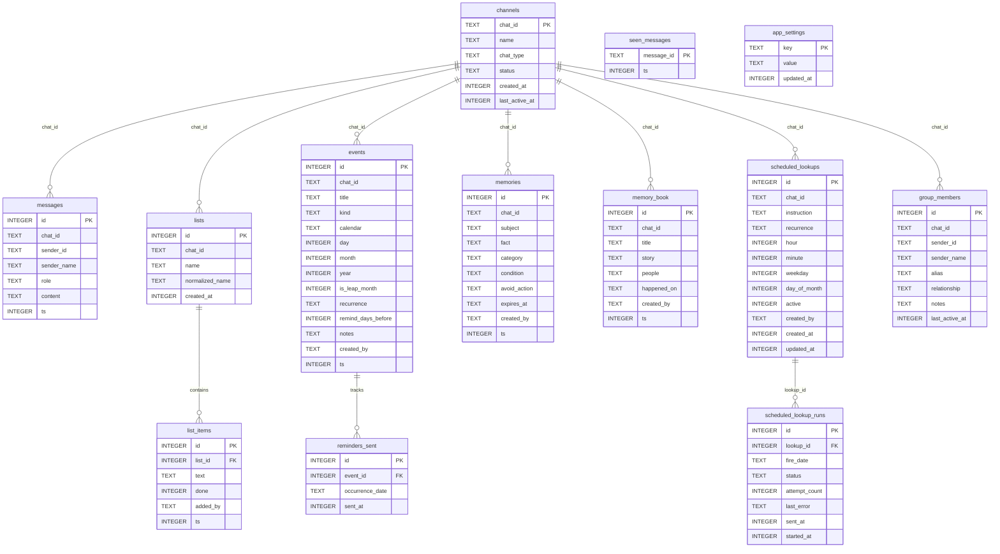

# Family Bot (Zalo Bot)

[](https://github.com/tranlehaiquan/46-bot/actions/workflows/ci.yml)
[](https://github.com/tranlehaiquan/46-bot/actions/workflows/cd.yml)

Trợ lý ảo thông minh, thân thiện dành riêng cho nhóm chat gia đình trên **Zalo**. Bot được xây dựng trên nền tảng **Node.js 22**, **TypeScript**, **Fastify**, **SQLite / libSQL / Turso**, tích hợp hàng đợi **Redis & BullMQ** cùng mô hình ngôn ngữ lớn (**Google Gemini 3.8 Flash / DeepSeek**) thông qua Vercel AI SDK với khả năng tự động gọi công cụ (Function Calling / Tool Calling) và giao diện quản trị **Web Admin Dashboard** trực quan.

---

## 🌟 What ZaloBot Can Do (Khả năng & Tính năng)

ZaloBot đóng vai trò là một thành viên hỗ trợ đa năng trong gia đình với các khả năng cốt lõi:

### 1. 🤖 Trò chuyện & Tương tác thông minh
- **Kích hoạt linh hoạt:** Phản hồi tự động khi được nhắc tên (`@bot`), khi có thành viên trong nhóm trả lời (`reply`) tin nhắn của bot, hoặc khi chat trực tiếp 1-1.
- **Phong cách thân thiện:** Giọng điệu ấm áp, tự nhiên, gần gũi như người trong gia đình; ngôn ngữ mặc định là tiếng Việt (tự động chuyển sang tiếng Anh nếu người dùng chat bằng tiếng Anh).
- **Định dạng hiển thị Zalo:** Tự động định dạng văn bản tương thích với Zalo (in đậm, in nghiêng, danh sách gạch đầu dòng, màu sắc Zalo `{green}...{/green}`, `{orange}...{/orange}`), tự loại bỏ các cú pháp không hỗ trợ như bảng Markdown hay link ẩn.
- **Nhận diện ngữ cảnh:** Lưu trữ lịch sử 20 lượt trò chuyện gần nhất, ghi nhận tên người gửi (Bố, Mẹ, Con...) để hiểu đúng ngữ cảnh và xưng hô chuẩn xác.

### 2. 📝 Quản lý danh sách dùng chung (Shared Lists)
- Tạo và quản lý nhiều danh sách khác nhau trong nhóm chat (ví dụ: *Đi chợ*, *Việc nhà*, *Đồ chuẩn bị đi du lịch*, *Đồ cần mua*...).
- Thêm một hoặc nhiều món cùng lúc vào danh sách.
- Đánh dấu hoàn thành (`[x]`) hoặc chưa hoàn thành (`[ ]`).
- Xóa món hoặc xem toàn bộ danh sách một cách trực quan, rõ ràng.

### 3. 📅 Quản lý Sự kiện & Nhắc nhở Âm / Dương lịch (Events & Reminders)
- **Lịch Âm & Dương chuẩn xác:** Tích hợp thuật toán chuyển đổi Âm lịch Việt Nam (múi giờ UTC+7, thiên văn Hồ Ngọc Đức), hỗ trợ chính xác cả năm nhuận và tháng nhuận.
- **Đa dạng loại sự kiện:** Quản lý ngày giỗ chạp (`gio`), sinh nhật (`birthday`), lịch hẹn khám bệnh (`appointment`), ngày kỷ niệm (`anniversary`), nhắc nhở việc quan trọng (`reminder`).
- **Tần suất lặp lại (Recurrence):** Tự động tính toán ngày kế tiếp cho các sự kiện định kỳ hàng năm (`yearly`), hàng tháng (`monthly`), hàng tuần (`weekly`), hàng ngày (`daily`), hoặc diễn ra một lần (`none`).
- **Nhắc nhở trước N ngày:** Cài đặt số ngày cần nhắc trước (`remindDaysBefore`) để gia đình chuẩn bị chu đáo (mua sắm đồ cúng giỗ, quà sinh nhật...).
- **Render ảnh lịch trực quan:** Hỗ trợ vẽ và gửi ảnh lịch âm dương hàng tháng sinh động trực tiếp vào khung chat.

### 4. 🇻🇳 Tra cứu & Đồng bộ Ngày lễ Việt Nam (Vietnamese Holidays)
- **Dữ liệu đầy đủ:** Cập nhật toàn bộ các ngày nghỉ lễ chính thức theo Bộ luật Lao động (Tết Nguyên Đán, Giỗ Tổ Hùng Vương, 30/4 - 1/5, Quốc khánh 2/9, Tết Dương lịch) cùng số ngày nghỉ quy định.
- **Lễ hội truyền thống:** Tra cứu các ngày lễ phong tục cổ truyền (Tết Trung Thu, Lễ Vu Lan, Tết Hàn Thực, Tết Đoan Ngọ, Tết Ông Công Ông Táo...).
- **Đồng bộ tự động:** Tính năng nhập tự động các ngày lễ vào lịch sự kiện của nhóm chat chỉ bằng một câu lệnh.

### 5. ⛅ Tra cứu Thời tiết & Dự báo (Weather Forecast)
- Tra cứu thời tiết thời gian thực và dự báo 1–3 ngày tới tại bất kỳ tỉnh thành, địa phương nào tại Việt Nam cũng như trên toàn thế giới qua wttr.in.
- Không cần cấu hình API key, phản hồi nhanh chóng với nhiệt độ thực tế, cảm giác ngoài trời, độ ẩm, sức gió và khả năng mưa.

### 6. 🎟️ Dò & Tra cứu Kết quả Xổ số (Lottery Checker)
- **Hỗ trợ toàn diện:** Tra cứu kết quả và tự động dò vé số kiến thiết cả 3 miền (Miền Bắc, Miền Nam, Miền Trung) và các dòng vé số Vietlott (Mega 6/45, Power 6/55).
- **Hỗ trợ qua ảnh:** Thành viên chỉ cần chụp và gửi ảnh vé số vào nhóm chat, bot kết hợp AI Vision đọc số vé, đài quay, ngày mở thưởng và tự động báo kết quả trúng thưởng.

### 7. 🎨 Tạo ảnh AI & Gửi Sticker sinh động
- **Tạo ảnh AI (Text-to-Image):** Tích hợp Google Imagen / Gemini Image model để vẽ tranh, tạo hình ảnh minh họa theo yêu cầu của thành viên và lưu trữ qua Zipline.
- **Sticker Zalo sống động:** Tự động gửi sticker biểu cảm phong phú (chào hỏi, cảm ơn, chúc mừng, buồn cười, tạm biệt...) từ các bộ sticker Zalo quen thuộc (SiuKay, Zapy, Anh Tre).

### 8. 🧠 Ký ức Gia đình & Cuốn sổ Kỷ niệm (Memory & Memory Book)
- **Ghi nhớ thông tin & thói quen:** Lưu lại sở thích, thói quen, chế độ dinh dưỡng (ví dụ: *Bố uống cà phê ít đường*, *Mẹ dị ứng hải sản*, *Bé Na học lớp 3*). Tự động phân cấp thông tin cốt lõi (`core`) và thông tin chung (`general`).
- **Ghi nhớ thụ động (Passive Memory):** Tự động phát hiện và trích xuất những thói quen, thông tin quan trọng qua các cuộc hội thoại thường nhật mà không cần ra lệnh trực tiếp.
- **Cuốn sổ Kỷ niệm (Memory Book):** Lưu lại những câu chuyện, cột mốc gia đình ý nghĩa (chuyến du lịch, ngày đầu tiên con biết bơi...) và cho phép tìm kiếm lại khi gia đình ôn chuyện cũ.
- **Bảo mật quyền riêng tư:** Tự động từ chối và chặn ghi nhớ các thông tin nhạy cảm như mật khẩu, tài khoản ngân hàng, số thẻ tín dụng hoặc CCCD.

### 9. 🔍 Tìm kiếm Web & Cào dữ liệu chuyên sâu
- **Tavily Search:** Tra cứu tin tức thời gian thực, giá vàng, thị trường, công thức nấu ăn.
- **Crawl4AI:** Đọc và tóm tắt sâu nội dung từ các đường link trang web (URL) được thành viên chia sẻ.

### 10. ⏰ Nhắc nhở & Bản tin tự động (Scheduler)
- **Bản tin buổi sáng (07:00):** Điểm tin ngày mới, sự kiện hôm nay, các ngày lễ hoặc sinh nhật/ngày giỗ sắp diễn ra trong 7 ngày tới.
- **Tổng kết tuần (Chủ nhật 20:00):** Tổng hợp lịch trình, kế hoạch và các việc cần chú ý cho tuần tới.
- **Lịch tra cứu định kỳ (Scheduled Lookups):** Đặt lịch tự động tra cứu nội dung định kỳ (báo thời tiết mỗi sáng, điểm giá vàng hàng ngày).
- **Chống gửi lặp:** Ghi nhận trạng thái gửi vào cơ sở dữ liệu để đảm bảo không bao giờ spam hay gửi trùng lặp.

### 11. 💻 Web Admin Dashboard
- Giao diện quản trị web hiện đại tích hợp sẵn tại `/admin` xây dựng bằng React 19, Vite, Radix UI Themes và Tailwind CSS.
- Cấu hình linh hoạt các thông số bot, chuyển đổi mô hình AI (Gemini/DeepSeek), quản lý API Keys, quản lý thành viên nhóm, duyệt kênh chat, tra cứu lịch và ký ức gia đình trực tiếp từ trình duyệt.

---

## 🛠️ Table of Tools (Bảng tra cứu công cụ của Bot)

Dưới đây là bảng tổng hợp các công cụ (tools) được tích hợp vào mô hình AI để tự động thực thi khi người dùng yêu cầu:

| Tên công cụ (Tool Name) | Nhóm chức năng | Mô tả chức năng | Tham số đầu vào (Parameters) | Ví dụ câu lệnh thực tế |
| :--- | :--- | :--- | :--- | :--- |
| `list_create` | **Danh sách (Lists)** | Tạo một danh sách mới cho nhóm chat. | • `name` *(string, bắt buộc)*: Tên danh sách. | *"Tạo cho mình danh sách Đi chợ"* |
| `list_add_item` | **Danh sách (Lists)** | Thêm một hoặc nhiều món vào danh sách đã có (tự động tạo mới nếu chưa có). | • `listName` *(string, bắt buộc)*<br>• `items` *(string[], bắt buộc)* | *"Thêm thịt bò, cà chua, hành lá vào danh sách Đi chợ"* |
| `list_check_item` | **Danh sách (Lists)** | Đánh dấu hoàn thành (`[x]`) hoặc chưa hoàn thành (`[ ]`). | • `listName` *(string, bắt buộc)*<br>• `itemText` *(string, bắt buộc)*<br>• `done` *(boolean, mặc định `true`)* | *"Đã mua thịt bò rồi nhé"*<br>*"Check xong cà chua trong danh sách Đi chợ"* |
| `list_remove_item` | **Danh sách (Lists)** | Xóa bỏ một món ra khỏi danh sách. | • `listName` *(string, bắt buộc)*<br>• `itemText` *(string, bắt buộc)* | *"Xóa cà chua khỏi danh sách Đi chợ"* |
| `list_show` | **Danh sách (Lists)** | Hiển thị nội dung chi tiết danh sách hoặc xem tất cả danh sách hiện có. | • `listName` *(string, tùy chọn)* | *"Xem danh sách Đi chợ"*<br>*"Nhóm mình có những danh sách nào?"* |
| `event_add` | **Sự kiện & Nhắc nhở (Events)** | Thêm sự kiện, lịch hẹn, sinh nhật, ngày giỗ chạp (hỗ trợ cả Dương lịch và Âm lịch). | • `title` *(string, bắt buộc)*<br>• `kind` *(enum: `event`, `reminder`, `birthday`, `anniversary`, `gio`, `appointment`)*<br>• `calendar` *(enum: `solar`, `lunar`, mặc định `solar`)*<br>• `day` *(number, 1–31)*<br>• `month` *(number, 1–12)*<br>• `year` *(number, tùy chọn)*<br>• `recurrence` *(enum: `none`, `yearly`, `monthly`, `weekly`, `daily`)*<br>• `remindDaysBefore` *(number)*<br>• `notes` *(string, tùy chọn)* | *"Nhắc ngày giỗ ông nội vào ngày 15 tháng 8 âm lịch hàng năm"*<br>*"Thêm sinh nhật Mẹ ngày 24/11 hàng năm, nhắc trước 3 ngày"* |
| `event_list_upcoming` | **Sự kiện & Nhắc nhở (Events)** | Liệt kê các sự kiện, ngày giỗ, sinh nhật sắp tới trong khoảng thời gian xác định. | • `windowDays` *(number, 1–365, mặc định `30`)* | *"Sắp tới có sự kiện hay ngày giỗ nào không?"*<br>*"Xem lịch sinh nhật trong 60 ngày tới"* |
| `event_update` | **Sự kiện & Nhắc nhở (Events)** | Cập nhật thông tin chi tiết của một sự kiện/lịch hẹn đã lưu theo ID. | • `id` *(number, bắt buộc)*<br>• Các trường tùy chọn cần cập nhật. | *"Đổi lịch khám mắt ID 3 sang ngày 15/10"* |
| `event_delete` | **Sự kiện & Nhắc nhở (Events)** | Xóa bỏ sự kiện/lịch hẹn theo ID. | • `id` *(number, bắt buộc)* | *"Xóa sự kiện ID 4"* |
| `holiday_list_upcoming`| **Ngày lễ Việt Nam (Holidays)** | Tra cứu các ngày nghỉ lễ chính thức hoặc lễ hội truyền thống sắp tới tại Việt Nam. | • `windowDays` *(number, mặc định `365`)*<br>• `publicOnly` *(boolean, mặc định `false`)* | *"Sắp tới có ngày nghỉ lễ nào không?"*<br>*"Bao giờ đến Tết Trung Thu?"* |
| `holiday_import` | **Ngày lễ Việt Nam (Holidays)** | Tự động thêm các ngày nghỉ lễ chính thức hoặc toàn bộ lễ hội truyền thống vào lịch nhóm. | • `includeTraditional` *(boolean, mặc định `false`)* | *"Lưu các ngày nghỉ lễ năm nay vào lịch nhóm"* |
| `weather_check` | **Thời tiết (Weather)** | Tra cứu thời tiết hiện tại và dự báo thời tiết 1–3 ngày tới tại bất kỳ tỉnh thành nào. | • `location` *(string, bắt buộc)*: Tên địa phương.<br>• `days` *(number, 1–3, mặc định `1`)* | *"Thời tiết Hà Nội hôm nay thế nào?"*<br>*"Dự báo thời tiết Đà Lạt 3 ngày tới"* |
| `lottery_check` | **Dò Vé Số (Lottery)** | Tra cứu kết quả xổ số 3 miền hoặc Vietlott và tự động so khớp vé trúng thưởng. | • `station` *(string, bắt buộc)*: Đài/tỉnh mở thưởng.<br>• `date` *(string, tùy chọn)*: Ngày mở thưởng.<br>• `ticketNumber` *(string, tùy chọn)*: Số vé cần dò. | *"Dò vé số TP.HCM ngày 20/10 số 750136"*<br>*"Kết quả xổ số Miền Bắc hôm nay"* |
| `image_generate` | **Tạo ảnh AI (Images)** | Tạo ảnh AI bằng Google Imagen/Gemini, tải lên Zipline và gửi ảnh trực tiếp vào nhóm chat. | • `prompt` *(string, bắt buộc)*: Mô tả ảnh cần tạo.<br>• `aspectRatio` *(enum: `1:1`, `3:4`, `4:3`, `9:16`, `16:9`)*<br>• `caption` *(string, tùy chọn)* | *"Vẽ cho mình chú mèo ngồi bên tách cà phê"*<br>*"Tạo ảnh phong cảnh hoàng hôn trên biển 16:9"* |
| `send_sticker` | **Sticker Zalo (Stickers)** | Gửi sticker Zalo sinh động phù hợp với ngữ cảnh hội thoại. | • `category` *(enum: `funny`, `greeting`, `thanks`, `celebration`, `done`, `confused`, `bye`)* | *"Gửi sticker cảm ơn cả nhà"*<br>*"Gửi sticker chúc mừng sinh nhật"* |
| `remember` | **Ghi nhớ (Memory)** | Ghi nhớ thói quen, sở thích, thông tin thành viên gia đình (có hỗ trợ điều kiện và ràng buộc). | • `subject` *(string, bắt buộc)*<br>• `fact` *(string, bắt buộc)*<br>• `category` *(enum: `core`, `general`)*<br>• `condition` *(string)*, `avoidAction` *(string)* | *"Nhớ là Bố thích uống cà phê ít đường"*<br>*"Mẹ dị ứng hành tây, nhớ nhắc khi chọn món"* |
| `list_memories` | **Ghi nhớ (Memory)** | Tra cứu danh sách các thông tin, thói quen đã lưu về gia đình hoặc thành viên cụ thể. | • `subject` *(string, tùy chọn)*<br>• `category` *(enum: `core`, `general`, `all`)* | *"Nhóm mình đã lưu những thói quen gì của Bố?"* |
| `memory_book_add` | **Sổ Kỷ niệm (Memory Book)** | Lưu câu chuyện, kỷ niệm gia đình ý nghĩa vào Cuốn sổ Kỷ niệm. | • `title` *(string, bắt buộc)*<br>• `story` *(string, bắt buộc)*<br>• `people` *(string)*, `happenedOn` *(string)* | *"Lưu vào sổ kỷ niệm: Chuyến đi Phú Quốc hè 2024 của cả nhà..."* |
| `memory_book_search` | **Sổ Kỷ niệm (Memory Book)** | Tìm kiếm các câu chuyện, kỷ niệm trong Cuốn sổ Kỷ niệm theo từ khóa. | • `query` *(string, bắt buộc)* | *"Tìm lại kỷ niệm chuyến đi Phú Quốc năm ngoái"* |
| `memory_search` | **Tìm kiếm Ký ức (Memory Search)**| Tìm kiếm thông minh kết hợp (hybrid) xếp hạng liên quan trên cả thói quen và sổ kỷ niệm. | • `query` *(string, bắt buộc)*<br>• `type` *(enum: `all`, `facts`, `stories`)*<br>• `limit` *(number, mặc định `10`)* | *"Cả nhà mình có kỷ niệm hay thói quen gì liên quan đến bơi lội không?"* |
| `list_group_members` | **Thành viên nhóm (Members)** | Xem danh sách thành viên trong nhóm, tên hiển thị, biệt danh, vai vế và ghi chú. | Không có tham số. | *"Xem danh sách thành viên trong nhóm mình"* |
| `update_group_member`| **Thành viên nhóm (Members)** | Cập nhật vai vế, biệt danh trong gia đình (Bố, Mẹ, Bé Bông...) cho một thành viên. | • `target` *(string)*, `alias` *(string)*, `relationship` *(string)*, `notes` *(string)* | *"Đặt biệt danh cho mình là Mẹ nhé"*<br>*"Ghi nhận anh Nam là Bố"* |
| `web_search` | **Tìm kiếm Web (Search)** | Tìm kiếm thông tin thời gian thực từ Internet qua Tavily Search API. | • `query` *(string, bắt buộc)*<br>• `maxResults` *(number, mặc định `3`)* | *"Giá vàng hôm nay bao nhiêu?"*<br>*"Cách nấu canh chua cá lóc miền Tây"* |
| `scrape_url` | **Cào web (Crawl4AI)** | Thu thập và đọc toàn bộ nội dung bài viết từ một đường link trang web. | • `url` *(string, bắt buộc, URL hợp lệ)* | *"Tóm tắt bài viết này giúp mình: https://..."* |
| `lookup_schedule_create` | **Lịch tra cứu (Lookups)** | Đặt lịch tra cứu thông tin Internet định kỳ (báo thời tiết mỗi sáng, cập nhật giá vàng). | • `instruction` *(string, bắt buộc)*<br>• `recurrence` *(enum: `daily`, `weekly`, `monthly`)*<br>• `time` *(string, HH:mm)* | *"Mỗi ngày lúc 7:00 sáng báo thời tiết TP.HCM"*<br>*"Hàng ngày 08:30 cập nhật giá vàng SJC"* |
| `lookup_schedule_list` | **Lịch tra cứu (Lookups)** | Xem danh sách các lịch tra cứu định kỳ của nhóm kèm trạng thái chạy gần nhất. | Không có tham số. | *"Xem danh sách lịch tra cứu của nhóm"* |
| `lookup_schedule_update` | **Lịch tra cứu (Lookups)** | Cập nhật chỉ dẫn, giờ chạy hoặc bật/tắt lịch tra cứu theo ID. | • `id` *(number, bắt buộc)*<br>• Các trường tùy chọn cập nhật. | *"Đổi lịch tra cứu số 1 sang 07:30"* |
| `lookup_schedule_cancel` | **Lịch tra cứu (Lookups)** | Hủy và xóa hoàn toàn lịch tra cứu định kỳ khỏi nhóm theo ID. | • `id` *(number, bắt buộc)* | *"Hủy lịch tra cứu số 2"* |

---

## 🏗️ Kiến trúc & Công nghệ (Tech Stack)

- **Ngôn ngữ & Runtime:** Node.js 22 (LTS), TypeScript (Strict Mode), ESM module.
- **Giao diện Web Admin:** React 19, Vite, Radix UI Themes, Tailwind CSS, Lucide Icons, Wouter routing.
- **Backend Server:** Fastify với Fastify Helmet, Fastify Rate Limit và Fastify Static (phục vụ dashboard tại `/admin`).
- **Giao thức Zalo:** Webhook API chính thức của Zalo thông qua thư viện `zalo-bot-js`. Tự động đăng ký webhook qua `setWebhook` khi khởi động.
- **AI Core:** Vercel AI SDK (`ai`), hỗ trợ Google Gemini (`@ai-sdk/google`) và DeepSeek (`@ai-sdk/deepseek`).
- **Cơ sở dữ liệu:** libSQL / Turso client (`@libsql/client`), hỗ trợ cả database SQLite cục bộ (`file:...`) và cloud distributed Turso database (`libsql://...` hoặc `https://...`).
- **Hàng đợi & Lập lịch (Scheduler):** Redis & BullMQ cho môi trường phân tán; tự động fallback sang in-process timer nếu không có Redis. Múi giờ mặc định: `Asia/Ho_Chi_Minh`.
- **Âm lịch Việt Nam:** Thuật toán thiên văn Hồ Ngọc Đức (GMT+7), hỗ trợ tính toán tháng nhuận và năm nhuận.
- **Thời tiết:** wttr.in JSON API (nhanh, miễn phí, hỗ trợ toàn cầu).
- **Lưu trữ hình ảnh:** Zipline API integration.
- **Triển khai (Deployment):** Docker Multi-stage build (Node 22-slim), Docker Compose, hỗ trợ Dokploy, VPS hoặc Kubernetes.

---

## 🗄️ Sơ đồ thực thể–quan hệ (ERD)

Cơ sở dữ liệu lưu dữ liệu theo nhóm chat (`chat_id`). Bảng `channels` quản lý trạng thái duyệt kênh (`active`, `pending`, `disabled`).



---

## ⚙️ Cấu hình môi trường (.env)

Tạo file `.env` dựa trên `.env.example` với các thông số cấu hình dưới đây:

### 1. Cấu hình cốt lõi (Bắt buộc)
| Biến môi trường | Bắt buộc | Mặc định | Mô tả chi tiết |
| :--- | :---: | :---: | :--- |
| `ZALO_BOT_TOKEN` | **Có** | — | Bot Token do Zalo Bot Platform cung cấp khi tạo bot. |
| `WEBHOOK_URL` | **Có** | — | Đường dẫn HTTPS công khai nhận webhook từ Zalo, ví dụ: `https://bot.example.com/webhooks/zalo`. |
| `WEBHOOK_SECRET` | **Có** | — | Chuỗi bí mật ngẫu nhiên (từ 8 đến 256 ký tự) dùng để ký và xác thực webhook qua header `X-Bot-Api-Secret-Token`. |
| `MODE` | **Có** | `webhook` | Chế độ nhận tin nhắn từ Zalo (bắt buộc đặt là `webhook`). |
| `PORT` | Không | `3000` | Cổng HTTP server Fastify lắng nghe. |
| `BOT_ID` | Tùy chọn | `""` | User ID của Bot trên Zalo, giúp bot nhận diện chính xác khi có người nhắc tên (@bot) hoặc trích dẫn (quote/reply) tin nhắn của bot. |

### 2. Cấu hình Quyền hạn & Phê duyệt Nhóm
| Biến môi trường | Bắt buộc | Mặc định | Mô tả chi tiết |
| :--- | :---: | :---: | :--- |
| `FAMILY_CHAT_IDS` | Không | `""` | Danh sách các `chat_id` của nhóm gia đình được cấp quyền (ngăn cách bằng dấu phẩy). Nếu để trống, bot chạy ở **Discovery Mode** và trả về ID nhóm kèm hướng dẫn duyệt. |
| `FAMILY_CHAT_ID` | Không | `""` | ID đơn lẻ của nhóm gia đình (hỗ trợ tương thích ngược). |
| `ADMIN_SENDER_IDS`| Tùy chọn | `""` | Danh sách Zalo User ID của quản trị viên (phân cách bằng dấu phẩy). |
| `ADMIN_PASSWORD` | Không | `admin123` | Mật khẩu đăng nhập vào giao diện Web Admin Dashboard tại `/admin`. |

### 3. Cấu hình Mô hình Ngôn ngữ AI (LLM)
> [!IMPORTANT]
> Bạn phải cung cấp ít nhất một trong hai: `GEMINI_API_KEY` (khuyên dùng, có gói miễn phí) hoặc `DEEPSEEK_API_KEY`.

| Biến môi trường | Bắt buộc | Mặc định | Mô tả chi tiết |
| :--- | :---: | :---: | :--- |
| `LLM_PROVIDER` | Không | Tự nhận diện | Nhà cung cấp AI: `gemini` hoặc `deepseek`. Tự động suy luận dựa trên API key được cung cấp. |
| `GEMINI_API_KEY` | Tùy chọn | — | API key của Google AI Studio (lấy miễn phí tại [Google AI Studio](https://aistudio.google.com/)). |
| `GEMINI_MODEL` | Không | `gemini-3.8-flash` | Tên mô hình văn bản Gemini sử dụng. |
| `GEMINI_IMAGE_MODEL`| Không | `gemini-3.1-flash-image` | Tên mô hình tạo ảnh AI (Google Imagen / Gemini Image). |
| `DEEPSEEK_API_KEY`| Tùy chọn | — | API key của DeepSeek (lấy tại [DeepSeek Platform](https://platform.deepseek.com/)). |
| `DEEPSEEK_MODEL` | Không | `deepseek-chat` | Tên mô hình DeepSeek (khuyến nghị dùng bản chat, không dùng reasoner). |

### 4. Cơ sở dữ liệu & Lưu trữ
| Biến môi trường | Bắt buộc | Mặc định | Mô tả chi tiết |
| :--- | :---: | :---: | :--- |
| `DB_PATH` | Không | `/data/family.db` | Đường dẫn file SQLite database nội bộ (gắn với volume Docker `/data`). |
| `TURSO_DATABASE_URL`| Tùy chọn | — | Địa chỉ kết nối Turso cloud database (`libsql://...` hoặc `https://...`). Nếu thiết lập, bot sẽ kết nối cloud database thay vì SQLite file cục bộ. |
| `TURSO_AUTH_TOKEN`| Tùy chọn | — | Auth token tương ứng của database Turso. |

### 5. Dịch vụ Mở rộng (Tìm kiếm, Cào web, Ảnh, Hàng đợi)
| Biến môi trường | Bắt buộc | Mặc định | Mô tả chi tiết |
| :--- | :---: | :---: | :--- |
| `TAVILY_API_KEY` | Tùy chọn | — | API key từ [Tavily](https://tavily.com/) cho tính năng `web_search` (miễn phí 1,000 lượt tìm kiếm/tháng). |
| `CRAWL4AI_API_TOKEN`| Tùy chọn | — | API token của Crawl4AI cho tính năng đọc sâu liên kết trang web `scrape_url`. |
| `ZIPLINE_URL` | Tùy chọn | — | URL máy chủ lưu trữ hình ảnh Zipline (dùng để lưu ảnh lịch tháng và ảnh AI tạo ra). |
| `ZIPLINE_TOKEN` | Tùy chọn | — | Token xác thực Zipline API. |
| `REDIS_URL` | Tùy chọn | `redis://redis:6379` | Đường dẫn kết nối Redis cho BullMQ scheduler. Để trống nếu chạy local mà không dùng Redis (tự động fallback về timer bộ nhớ). |
| `SCHEDULER_CONCURRENCY`| Không | `5` | Số tác vụ chạy đồng thời tối đa của scheduler. |
| `PASSIVE_MEMORY_ENABLED`| Không | `true` | Bật/tắt tính năng tự động trích xuất ký ức thụ động qua tin nhắn hội thoại thường ngày. |
| `TZ` | Không | `Asia/Ho_Chi_Minh` | Múi giờ hệ thống (khuyên dùng `Asia/Ho_Chi_Minh` để nhắc lịch chuẩn xác). |

---

## 📖 Hướng dẫn Cài đặt & Triển khai Bot (Setup Guide)

### 📌 Bước 1: Đăng ký & Chuẩn bị Bot Zalo

1. **Tạo Bot trên Zalo:**
   - Sử dụng tài khoản Zalo của bạn, truy cập vào nền tảng **Zalo Bot Platform** (hoặc tìm kiếm bot tạo bot chính thức của Zalo).
   - Đặt tên cho bot (ví dụ: `Family Bot` hoặc `Trợ Lý Gia Đình`) và nhận **Bot Token**.
   - Lưu lại **Bot Token** này để điền vào biến `ZALO_BOT_TOKEN`.
   - Ghi lại **Bot ID** (User ID của bot) để điền vào `BOT_ID` (giúp bot nhận diện chính xác khi có người nhắc tên @bot hoặc reply tin nhắn của bot trong nhóm).
2. **Chuẩn bị API Key AI:**
   - Truy cập [Google AI Studio](https://aistudio.google.com/) để lấy `GEMINI_API_KEY` (hoàn toàn miễn phí với hạn mức thoải mái cho gia đình).
   - *(Tùy chọn)* Đăng ký [Tavily Search](https://tavily.com/) để lấy `TAVILY_API_KEY` miễn phí 1.000 lượt tìm kiếm/tháng.
3. **Mời Bot vào nhóm chat gia đình:**
   - Mời tài khoản Bot vừa tạo vào nhóm chat gia đình trên Zalo của bạn.

---

### 💻 Bước 2A: Chạy phát triển cục bộ (Local Development)

Nếu bạn muốn chạy thử nghiệm trên máy tính cá nhân (macOS, Linux, Windows WSL):

#### 1. Yêu cầu môi trường
- **Node.js:** phiên bản `>= 22.0.0`
- **pnpm:** phiên bản `>= 12.0.0` (Cài đặt: `npm install -g pnpm@12.14.0`)

#### 2. Cài đặt mã nguồn & dependencies
```bash
# Clone repository
git clone https://github.com/tranlehaiquan/46-bot.git
cd 46-bot

# Cài đặt toàn bộ dependencies trong workspace
pnpm install
```

#### 3. Tạo đường hầm HTTPS công khai (HTTPS Tunnel)
Zalo Webhook yêu cầu địa chỉ webhook phải là HTTPS công khai. Khi chạy dưới máy local, bạn cần dùng Cloudflare Tunnel hoặc Ngrok:

- **Dùng Cloudflare Tunnel (Miễn phí, không cần đăng ký tài khoản):**
  ```bash
  cloudflared tunnel --url http://localhost:3000
  ```
  Bạn sẽ nhận được một địa chỉ HTTPS dạng: `https://xxxx-xxxx.trycloudflare.com`.

- **Hoặc dùng Ngrok:**
  ```bash
  ngrok http 3000
  ```
  Bạn sẽ nhận được địa chỉ dạng: `https://xxxx.ngrok-free.app`.

#### 4. Cấu hình file `.env`
Sao chép file cấu hình mẫu và điền các thông số:
```bash
cp .env.example .env
```
Chỉnh sửa file `.env`:
```env
ZALO_BOT_TOKEN=your_zalo_bot_token_here
BOT_ID=your_bot_id_here
WEBHOOK_URL=https://xxxx-xxxx.trycloudflare.com/webhooks/zalo
WEBHOOK_SECRET=chuoi_bi_mat_ngau_nhien_16_ky_tu_tro_len
MODE=webhook
PORT=3000

# LLM
LLM_PROVIDER=gemini
GEMINI_API_KEY=your_gemini_api_key_here
GEMINI_MODEL=gemini-3.8-flash

# Database SQLite cục bộ
DB_PATH=./data/family.db

# Mật khẩu Web Admin Dashboard
ADMIN_PASSWORD=admin123

# Để trống FAMILY_CHAT_IDS ở lần chạy đầu tiên để dùng Discovery Mode
FAMILY_CHAT_IDS=
```

#### 5. Khởi động ứng dụng
```bash
# Chạy đồng thời cả Backend và Admin Frontend (Vite hot reload):
pnpm dev

# Hoặc chỉ chạy Backend:
pnpm dev:backend
```

Khi backend khởi động, hàm `syncWebhook` sẽ tự động gọi API `setWebhook` của Zalo để đăng ký địa chỉ `WEBHOOK_URL`. Bạn sẽ thấy log dạng:
```json
{"event":"setWebhook","outcome":"success"}
```

---

### 🐳 Bước 2B: Triển khai với Docker Compose (VPS / Server riêng)

Đây là phương thức triển khai tiện lợi nhất cho máy chủ cá nhân hoặc VPS có cài sẵn Docker:

1. Clone mã nguồn về VPS và tạo file `.env`:
   ```bash
   git clone https://github.com/tranlehaiquan/46-bot.git
   cd 46-bot
   cp .env.example .env
   nano .env
   ```
2. Điền đầy đủ thông tin vào `.env`:
   - `ZALO_BOT_TOKEN`
   - `WEBHOOK_URL=https://your-domain.com/webhooks/zalo`
   - `WEBHOOK_SECRET=chuoi_ngau_nhien_bao_mat`
   - `GEMINI_API_KEY=...`
   - `ADMIN_PASSWORD=mat_khau_quan_tri_an_toan`
3. Khởi động hệ thống bằng Docker Compose:
   ```bash
   docker compose up -d --build
   ```
   *Docker Compose sẽ tự động khởi động 2 service:*
   - **`bot`**: Chạy backend Fastify (cổng 3000) phục vụ cả Webhook Zalo và giao diện Web Admin Dashboard tại `/admin`, mount volume `bot-data` vào `/data`.
   - **`redis`**: Chạy Redis 7 Alpine làm hàng đợi tác vụ cho BullMQ scheduler, mount volume `redis-data`.
4. Cấu hình Nginx / Caddy Reverse Proxy trỏ tên miền của bạn về cổng `3000` với SSL Let's Encrypt.
5. Xem log khởi động:
   ```bash
   docker compose logs -f bot
   ```

---

### 🚀 Bước 2C: Triển khai trên Dokploy (Khuyến nghị cho Production)

Nếu bạn dùng nền tảng quản trị PaaS **Dokploy**:

#### Bước 1: Tạo Project trên Dokploy
1. Đăng nhập giao diện Dokploy, chọn **Create Project** -> **Docker Compose**.
2. Đặt tên project (ví dụ: `family-bot`).
3. Trong phần Source, chọn **Git Repository** và kết nối tới repository `tranlehaiquan/46-bot` (nhánh `main`).

#### Bước 2: Cài đặt Biến môi trường (Environment Variables)
Trong tab **Environment** của Dokploy, dán nội dung từ file `.env` của bạn:
- `ZALO_BOT_TOKEN`: Token lấy từ Zalo Bot Platform.
- `WEBHOOK_URL`: Điền chính xác `https://bot.example.com/webhooks/zalo` (thay bằng domain của bạn).
- `WEBHOOK_SECRET`: Một chuỗi bí mật ngẫu nhiên tối thiểu 16 ký tự.
- `MODE`: `webhook`
- `PORT`: `3000`
- `LLM_PROVIDER`: `gemini`
- `GEMINI_API_KEY`: API key Google AI Studio.
- `ADMIN_PASSWORD`: Mật khẩu bảo vệ Web Admin Dashboard.
- `DB_PATH`: `/data/family.db`
- `FAMILY_CHAT_IDS`: Tạm thời để trống ở lần deploy đầu tiên.

#### Bước 3: Cấu hình Tên miền & SSL (Traefik)
1. Trong mục **Domains** trên Dokploy, bấm **Add Domain**.
2. Nhập domain của bạn (ví dụ: `bot.example.com`).
3. Chọn Service Name: `bot`, Container Port: `3000`.
4. Bật tùy chọn **HTTPS** (Dokploy tự động cấp phát chứng chỉ SSL Let's Encrypt miễn phí).

#### Bước 4: Deploy ứng dụng
1. Bấm **Deploy**.
2. Xem mục **Logs**: Xác nhận ứng dụng đã build xong cả frontend và backend, container khởi động thành công và tự động đăng ký `setWebhook` với Zalo.

---

### 📦 Bước 2D: Sử dụng Docker Image đóng gói sẵn từ GHCR

Dự án tự động build và đẩy image Docker lên GitHub Container Registry (GHCR) qua GitHub Actions:

```bash
# Kéo image mới nhất
docker pull ghcr.io/tranlehaiquan/46-bot:latest

# Tạo thư mục lưu dữ liệu SQLite
mkdir -p data

# Chạy container trực tiếp với file .env
docker run -d \
  --name family-bot \
  --restart unless-stopped \
  -p 3000:3000 \
  -v $(pwd)/data:/data \
  --env-file .env \
  ghcr.io/tranlehaiquan/46-bot:latest
```

---

## 🔑 Kích hoạt Nhóm Chat & Cơ chế Phê duyệt (Discovery Mode)

Sau khi bot đã khởi động thành công, hãy thực hiện kích hoạt nhóm chat theo các bước sau:

1. **Mời Bot vào nhóm chat gia đình** trên Zalo.
2. **Gửi tin nhắn nhắc tên bot** trong nhóm:
   ```text
   @FamilyBot xin chào
   ```
3. **Phản hồi từ Bot:**
   Do nhóm này chưa được phê duyệt trong danh sách cho phép, bot sẽ tự động trả lời thông báo kèm ID nhóm:
   ```text
   Kênh/nhóm này đang chờ quản trị viên phê duyệt trên Dashboard (chat ID "zgr-98a4f1a7dfc5369b6fd4").
   ```
4. **Phê duyệt nhóm (Chọn 1 trong 2 cách):**
   - **Cách 1: Phê duyệt nhanh qua Web Admin Dashboard (Khuyên dùng):**
     1. Mở trình duyệt và truy cập `https://bot.example.com/admin` (hoặc `http://localhost:3000/admin`).
     2. Đăng nhập bằng mật khẩu `ADMIN_PASSWORD`.
     3. Vào tab **Kênh (Channels)**: Bạn sẽ thấy nhóm mới đang ở trạng thái `Chờ duyệt` (`pending`).
     4. Bấm nút **Phê duyệt (Approve)**.
     5. Bot sẽ ngay lập tức gửi một tin nhắn vào nhóm: *"Kênh/nhóm này đã được quản trị viên phê duyệt. Bạn có thể bắt đầu trò chuyện với bot nhé."*
   - **Cách 2: Cập nhật qua file `.env`:**
     1. Sao chép chuỗi chat ID (ví dụ: `zgr-98a4f1a7dfc5369b6fd4`).
     2. Mở file `.env` (hoặc cấu hình Environment trên Dokploy/VPS), cập nhật:
        ```env
        FAMILY_CHAT_IDS=zgr-98a4f1a7dfc5369b6fd4
        ```
        *(Nếu có nhiều nhóm, phân cách bằng dấu phẩy: `zgr-nhom1,zgr-nhom2`)*.
     3. Khởi động lại (Redeploy) bot.

Từ thời điểm này, bot sẽ phản hồi đầy đủ các câu hỏi, thực thi công cụ và hỗ trợ các thành viên trong gia đình!

---

## 🖥️ Hướng dẫn sử dụng Web Admin Dashboard

Bot đi kèm giao diện web quản trị đầy đủ tính năng phục vụ việc giám sát và vận hành:

- **Đường dẫn truy cập:**
  - Cục bộ: `http://localhost:3000/admin/` (hoặc port của bạn)
  - Production: `https://bot.example.com/admin/`
- **Đăng nhập:** Nhập mật khẩu đã cấu hình tại `ADMIN_PASSWORD` (mặc định: `admin123`).

### Các phân hệ chính trong Dashboard:
1. **Cài đặt Hệ thống (Settings):**
   - Đổi nhà cung cấp AI linh hoạt giữa **Gemini** và **DeepSeek**.
   - Cập nhật tên mô hình, API Keys (Gemini, DeepSeek, Tavily, Crawl4AI, Zipline) tức thì vào cơ sở dữ liệu **mà không cần khởi động lại bot hay redeploy container**.
   - Bật/tắt tính năng ghi nhớ thụ động (Passive Memory).
2. **Quản lý Kênh (Channels):**
   - Xem danh sách toàn bộ các nhóm chat và cuộc trò chuyện cá nhân.
   - Phê duyệt kênh mới (`Active`), tạm dừng hoạt động (`Pending`), hoặc chặn kênh (`Disabled`).
3. **Thành viên Nhóm (Group Members):**
   - Xem danh sách thành viên đang hoạt động trong từng nhóm.
   - Thiết lập biệt danh, vai vế gia đình (Bố, Mẹ, Con gái cả, Em út...) và ghi chú cá nhân để bot xưng hô chuẩn mực và ấm cúng.
4. **Ký ức & Sổ Kỷ niệm (Memories):**
   - Quản lý các thông tin thói quen đã lưu theo nhóm chat.
   - Phân loại thông tin cốt lõi (`core`) hoặc chung (`general`).
   - Xem và tìm kiếm các mốc kỷ niệm gia đình trong Cuốn sổ Kỷ niệm.
5. **Sự kiện & Lịch định kỳ (Events & Lookups):**
   - Xem danh sách các ngày giỗ, sinh nhật, lịch hẹn âm dương.
   - Giám sát các lịch tra cứu tự động hàng ngày (báo thời tiết, giá vàng) và lịch sử lần chạy gần nhất.

---

## 💻 Phát triển cục bộ & Kiểm thử (Commands & Testing)

Dự án cấu hình monorepo qua `pnpm-workspace.yaml` với 2 package: `@bot/backend` và `@bot/admin`.

```bash
# 1. Cài đặt toàn bộ dependencies
pnpm install

# 2. Chạy môi trường phát triển (chạy đồng thời backend & admin frontend)
pnpm dev

# Chạy riêng từng module:
pnpm dev:backend   # Fastify backend với tsx watch
pnpm dev:admin     # Vite dev server cho admin UI

# 3. Kiểm tra kiểu dữ liệu toàn bộ workspace (Strict TypeScript)
pnpm typecheck

# 4. Chạy toàn bộ bộ test suites (340+ tests kiểm tra toàn diện)
pnpm test

# 5. Chạy kiểm tra riêng từng nhóm công cụ:
pnpm test src/tools/lists.test.ts          # Kiểm tra nhóm công cụ danh sách
pnpm test src/tools/events.test.ts         # Kiểm tra nhóm sự kiện & âm lịch
pnpm test src/tools/holidays.test.ts       # Kiểm tra ngày lễ Việt Nam
pnpm test src/tools/weather.test.ts        # Kiểm tra tra cứu thời tiết
pnpm test src/tools/lottery.test.ts        # Kiểm tra dò vé số 3 miền & Vietlott
pnpm test src/tools/memory.test.ts         # Kiểm tra ký ức gia đình
pnpm test src/tools/sticker.test.ts        # Kiểm tra gửi sticker Zalo
pnpm test src/tools/image-generation.test.ts # Kiểm tra tạo ảnh AI
pnpm test src/admin/admin-api.test.ts      # Kiểm tra Admin API & Auth

# 6. Build dự án cho production
pnpm build
```

---

## 🔄 CI/CD Pipelines & Container Registry

Dự án sử dụng **GitHub Actions** để tự động hóa toàn diện quy trình kiểm thử, build và phát hành container Docker:

### 1. Continuous Integration (`.github/workflows/ci.yml`)
- **Kích hoạt:** Khi có commit push hoặc tạo `Pull Request` vào nhánh `main`.
- **Nội dung kiểm tra:**
  - Thiết lập môi trường Node.js 22 và pnpm 12 kèm cache pnpm store tự động.
  - Cài đặt dependencies với `pnpm install --frozen-lockfile`.
  - Kiểm tra kiểu dữ liệu toàn bộ monorepo: `pnpm typecheck`.
  - Chạy toàn bộ test suites: `pnpm test`.
  - Build thử nghiệm bundle: `pnpm build` (build cả frontend admin và compile backend).
  - Kiểm tra Dockerfile: Build thử nghiệm image Docker multi-stage mà không đẩy lên registry (`push: false`) kèm Buildx cache.

### 2. Continuous Delivery (`.github/workflows/cd.yml`)
- **Kích hoạt:** Khi push tag phiên bản (`v*.*.*`), khi merge vào nhánh `main`, hoặc kích hoạt thủ công qua `workflow_dispatch`.
- **Phát hành (GHCR):** Tự động đóng gói và xuất bản image Docker tới GitHub Container Registry:
  ```text
  ghcr.io/<owner>/46-bot:latest
  ghcr.io/<owner>/46-bot:sha-<commit-hash>
  ghcr.io/<owner>/46-bot:vX.Y.Z
  ```

---

## 🔒 Xử lý sự cố thường gặp (Troubleshooting)

### 1. Webhook trả về lỗi `401 Unauthorized`
- **Nguyên nhân:** Mã bí mật trong header `X-Bot-Api-Secret-Token` từ Zalo gửi tới không khớp với `WEBHOOK_SECRET` trong cấu hình bot.
- **Cách khắc phục:** Kiểm tra lại giá trị `WEBHOOK_SECRET` trong `.env`. Đảm bảo chuỗi bí mật dài từ 8 đến 256 ký tự và không chứa khoảng trắng thừa ở hai đầu. Khi bot khởi động lại, bot sẽ tự động cập nhật lại secret với Zalo qua API `setWebhook`.

### 2. Bot không phản hồi trong nhóm chat Zalo
- **Nguyên nhân 1:** Chưa tag bot hoặc chưa reply tin nhắn của bot. Trong các nhóm chat Zalo, bot chỉ nhận được sự kiện webhook khi thành viên **gõ `@tên_bot`** hoặc ấn **Trả lời (Reply)** vào tin nhắn trước đó của bot.
- **Nguyên nhân 2:** Nhóm chat chưa được phê duyệt. Kiểm tra log hoặc truy cập `/admin` mục **Kênh** để xem nhóm có đang ở trạng thái `pending` hay không và bấm **Phê duyệt**.
- **Nguyên nhân 3:** `BOT_ID` chưa được cấu hình hoặc cấu hình sai, dẫn đến bot không nhận diện được lượt mention là dành cho mình. Hãy kiểm tra lại `BOT_ID` trong `.env`.

### 3. Dữ liệu (danh sách, sự kiện, ký ức) bị mất sau khi redeploy
- **Nguyên nhân:** Container không được gắn volume lưu trữ bền vững.
- **Cách khắc phục:** Đảm bảo container Docker đang mount volume `bot-data` vào thư mục `/data` (ví dụ: `-v $(pwd)/data:/data` hoặc cấu hình volume trong `docker-compose.yml`). Nếu dùng Turso cloud database (`TURSO_DATABASE_URL`), dữ liệu luôn được lưu an toàn trên đám mây.

### 4. Lỗi khi sử dụng tính năng Tạo ảnh AI (`image_generate`)
- **Nguyên nhân:** Tính năng tạo ảnh AI yêu cầu cấu hình đầy đủ cả `GEMINI_API_KEY` và dịch vụ lưu trữ hình ảnh `ZIPLINE_URL` cùng `ZIPLINE_TOKEN`.
- **Cách khắc phục:** Cập nhật các thông số Zipline trong trang **Cài đặt** của Web Admin Dashboard hoặc trong file `.env`.

### 5. Tin nhắn Zalo bị lỗi ký tự hoặc xuống dòng xấu
- Bot đã tích hợp bộ lọc làm sạch văn bản outbound (`cleanOutboundText`) tự động chuyển đổi định dạng và loại bỏ các ký tự phân cách kẻ ngang (`---`) hay bảng biểu không tương thích với Zalo, đồng thời tự động gửi fallback dạng văn bản thuần nếu Zalo từ chối gói tin Markdown.

---

## 📄 License

Dự án được phát triển cho mục đích gia đình và cộng đồng. Giữ nguyên bản quyền mã nguồn khi sử dụng hoặc phát triển thêm.
